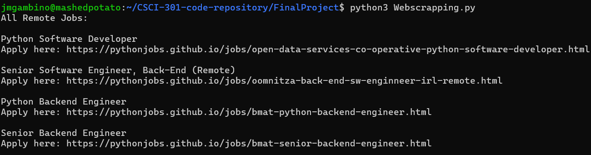
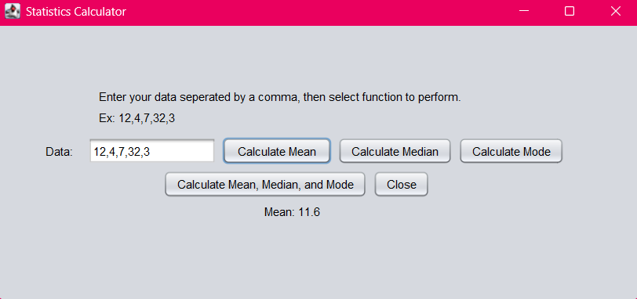
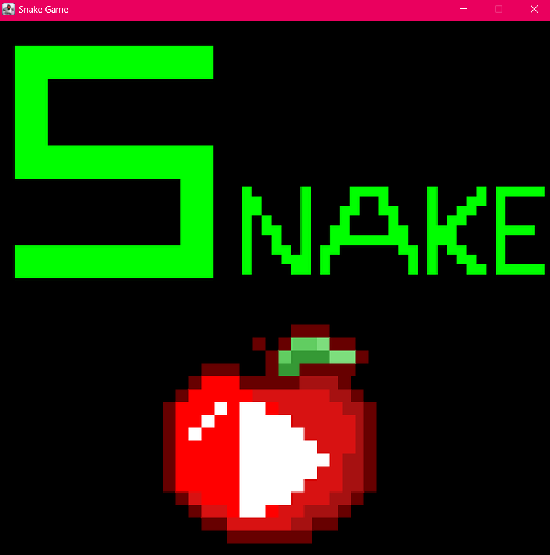
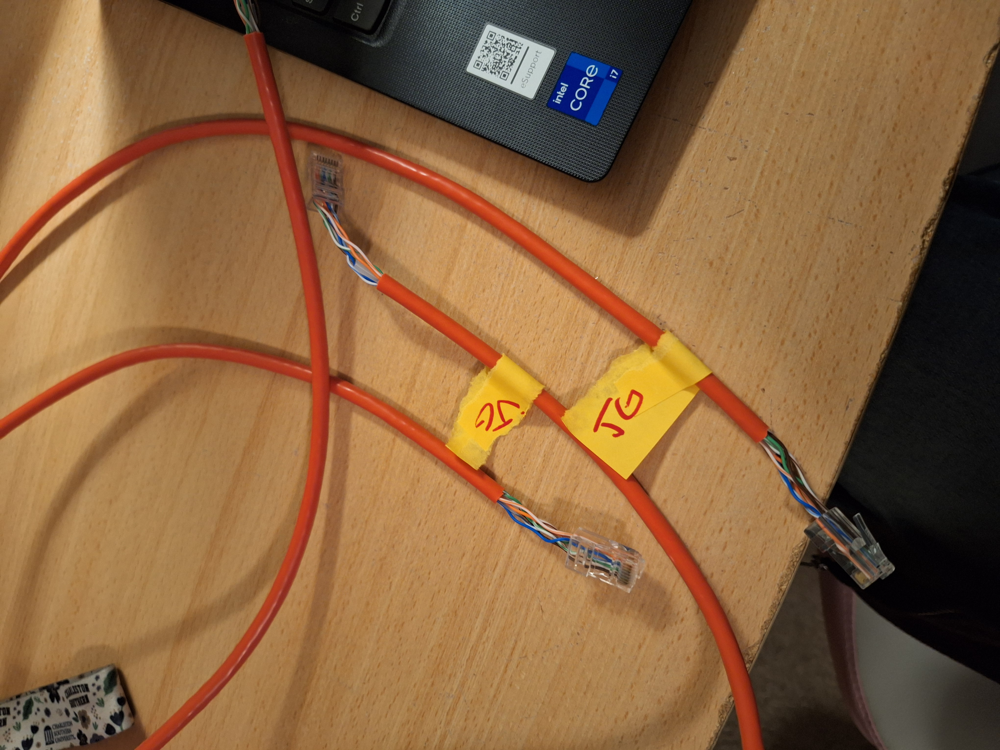

Portfolio
=========

Programming Projects
--------------------

*For access to my private project repositories, please [email me](mailto:jmgambino@student.csuniv.edu?subject=GitHub+Access) with the subject line, GitHub Access.

---
### [Final Project - Web-Scrapping | CSCI 301](project1)

---
### [Statistics GUI Calculator | CSCI 325](project2)

---
### [Final Project - Snake | CSCI 325](project3)

---
### [LAN Website | CSCI 332](project4)

---

Ethics Papers
-------------

### [Ethics Paper](/pdf/CSCI325EthicsPaper.pdf)

-   **Class:** CSCI 325 - Object-Oriented Programming 
-   **Grade:** 90/100

### [Ethics Paper - CSCI 419](/pdf/ethicsPaperCSCI419.pdf)

-   **Class:** CSCI 419 - Database Management
-   **Grade:** 100/100

### [Ethics of Artificial Intelligence](/pdf/ethicsPaperCSCI301.pdf)

-   **Class:** CSCI 301 - Survey of Scripting Languages
-   **Grade:** 100/100

---

Presentations
-------------

### [Presentation 1: Snake Game Demo](/video/snakeDemo.mp4)

- **Class:** CSCI 325 - Object Oriented Programming
- **Grade:** 95/100

### [Presentation 2: Snake Game Presentation](/pdf/SNAKE-FINAL-PROJECT.pdf)

- **Class:** CSCI 325 - Object Oriented Programming
- **Grade:** 95/100

---

Page template forked from <a href="https://github.com/csu-cs/csci-portfolio">CSU-CS</a>

<!-- Remove above link if you don't want to attributive -->
