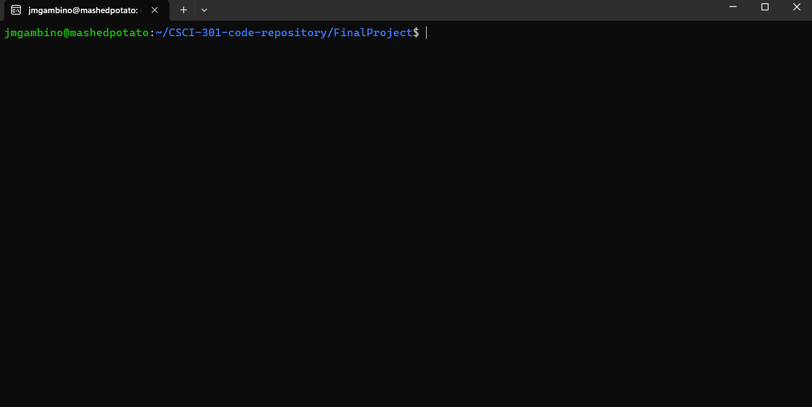
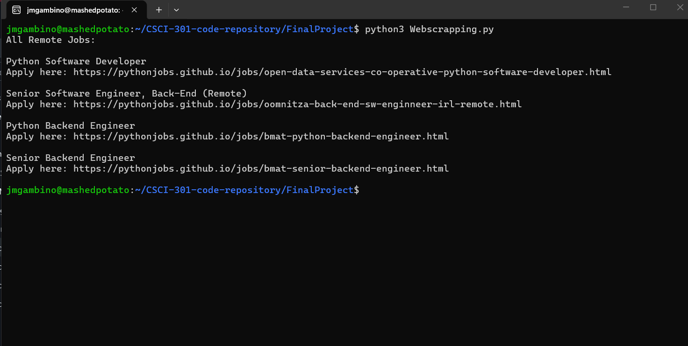
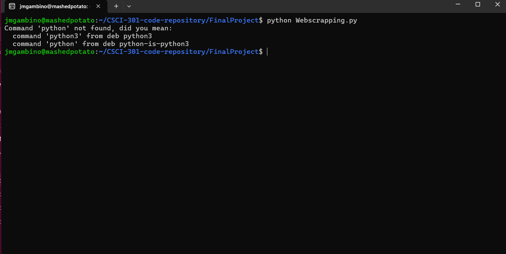

[Back to Portfolio](./)

Final Project - Web-Scrapping
===============

-   **Class:** Survey of Scripting Languages - CSCI 301
-   **Grade:** 100/100
-   **Language(s):** Python
-   **Source Code Repository:** [Web-Scrapping](https://github.com/jessica1620/WebscrappingFinal)  
    (Please [email me](mailto:jmgambino@student.csuniv.edu?subject=GitHub+Access) to request access.)

## Project description

This program is a Python script that was written and executed in the Ubuntu terminal. It uses the "Requests" and "BeautifulSoup" libraries to scrape information from the [Python Jobs website](https://pythonjobs.github.io/). The program searches through the available job listings and filters them to find positions that include remote work. For each matching job, it displays the job title and an application link if one is available. This makes it easier to find remote Python job opportunities without having to manually search through every listing on the website.

## How to compile and run the program

Download the file from the GitHub repository. From your terminal, move to the correct directory using:
```bash
cd [insert name of directory where the downloaded file is]
cd WebscrappingFinal
```
Once in the correct directory, from your terminal, type the following:
```bash
python3 Webscrapping.py
```
to run the program.
If it does not work, try `python` instead of `python3`.

## UI Design

You will start with your blank terminal before running the program (see Fig 1), and when the program is run properly, it will show the correct output of the remote jobs from the website (see Fig 2). If the program is not run properly, it will bring up an error. [Example: If using one of the commands does not work.\] (see Fig 3). 

  
Fig 1. The blank terminal before running.

  
Fig 2. Correct output of remote jobs

  
Fig 3. Feedback when an error occurs.

For more details see [GitHub Flavored Markdown](https://guides.github.com/features/mastering-markdown/).

[Back to Portfolio](./)
