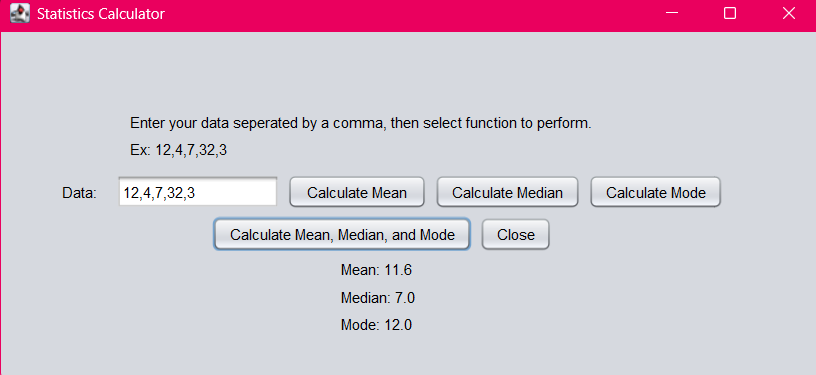

[Back to Portfolio](./)

Statistics GUI Calculator
===============

-   **Class:** Object Oriented Programming - CSCI 325
-   **Grade:** 100/100
-   **Language(s):** Java
-   **Source Code Repository:** [Statistics GUI Calculator](https://github.com/jessica1620/Statistics-GUI-Calculator/tree/main)  
    (Please [email me](mailto:jmgambino@student.csuniv.edu?subject=GitHub+Access) to request access.)

## Project description

This program is a GUI program in Java created on NetBeans. It is a Statistics Calculator that calculates the mean, median, and/or mode of any numbers you enter in the input box. The input box takes comma separated values (CSV), and once the input is entered, you may select the buttons to choose what kind of calculation you would like. It can calculate mean, median, and mode individually or simultaneously. Once a selection is made, the program will "clean" the data by removing commas, separating the numbers, storing them for further calculation (until the input box is changed with new values or the program is closed), and calculating as a calculator would.

## How to compile and run the program

In the terminal, navigate the the directory that has the file using:
```bash
cd [name of your directory]
```
Compile and run the program by using the commands:
```bash
javac statisticsGUI.java
java statisticsGUI
```

## UI Design

The user can type the numbers they wish to calculate into the input box and press the buttons for the desired calculation. For mean calculation, select the `Calculate Mean` button (see Fig 1). For median calculation, select the `Calculate Median` button (see Fig 2). For mode calculation, select the `Calculate Mode` button (see Fig 3). To calculate all three simultaneously, select the `Calculate Mean, Median, and Mode` button (see Fig 4). The user can also change the input at any time and do new desired calculations. When finished, the user may select the `Close` button to exit the program.

  
Fig 1. Calculation of the mean.

  
Fig 2. Calculation of the median.

  
Fig 3. Calculation of the mode.

  
Fig 4. All three calculations together.

For more details see [GitHub Flavored Markdown](https://guides.github.com/features/mastering-markdown/).

[Back to Portfolio](./)
