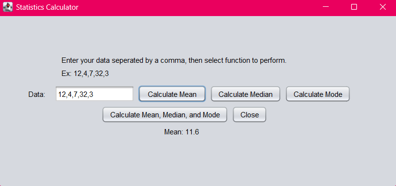
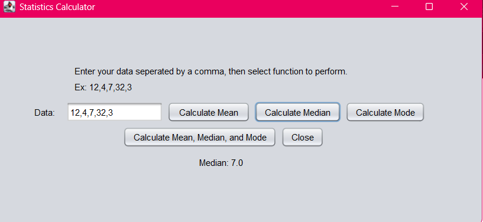
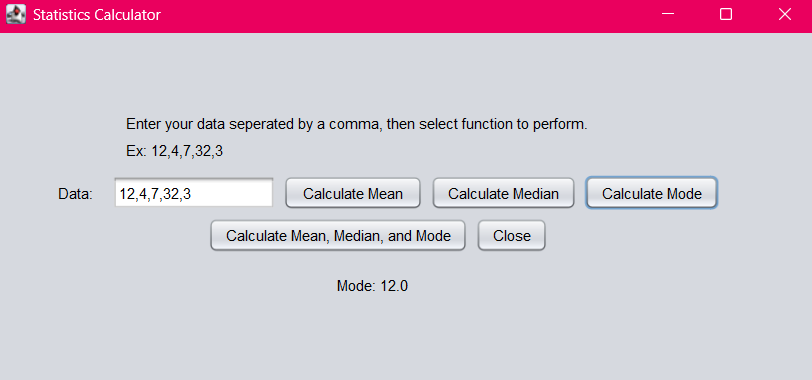

[Back to Portfolio](./)

Statistics GUI Calculator
===============

-   **Class:** Object Oriented Programming - CSCI 325
-   **Grade:** 100/100
-   **Language(s):** Java
-   **Source Code Repository:** [Statistics GUI Calculator](https://github.com/jessica1620/Statistics-GUI-Calculator/tree/main)  
    (Please [email me](mailto:jmgambino@student.csuniv.edu?subject=GitHub+Access) to request access.)

## Project description

This program is a GUI program in Java created on NetBeans. It is a Statistics Calculator that calculates the mean, median, and/or mode of any numbers you enter in the input box. The input box takes comma separated values (CSV), and once the input is entered, you may select the buttons to choose what kind of calculation you would like. It can calculate mean, median, and mode individually or simultaneously. Once a selection is made, the program will "clean" the data by removing commas, separating the numbers, storing them for further calculation (until the input box is changed with new values or the program is closed), and calculating as a calculator would.

## How to compile and run the program

In the terminal, navigate the the directory that has the file using:
```bash
cd [name of your directory]
```
Compile and run the program by using the commands:
```bash
javac statisticsGUI.java
java statisticsGUI
```

## UI Design

Almost every program requires user interaction, even command-line programs. Include in this section the tasks the user can complete and what the program does. You don't need to include how it works here; that information may go in the project description or in an additional section, depending on its significance.

Lorem ipsum dolor sit amet (see Fig 1), consectetur adipiscing elit, sed do eiusmod tempor incididunt ut labore et dolore magna aliqua. Ut enim ad minim veniam, quis nostrud exercitation ullamco laboris nisi ut aliquip ex ea commodo consequat (see Fig 2). Duis aute irure dolor in reprehenderit in voluptate velit esse cillum dolore eu fugiat nulla pariatur. Excepteur sint occaecat cupidatat non proident, sunt in culpa qui officia deserunt mollit anim id est laborum (see Fig 3).

  
Fig 1. Calculation of the mean.

  
Fig 2. Calculation of the median.

  
Fig 3. Calculation of the mode.

  
Fig 4. All three calculations together.

For more details see [GitHub Flavored Markdown](https://guides.github.com/features/mastering-markdown/).

[Back to Portfolio](./)
