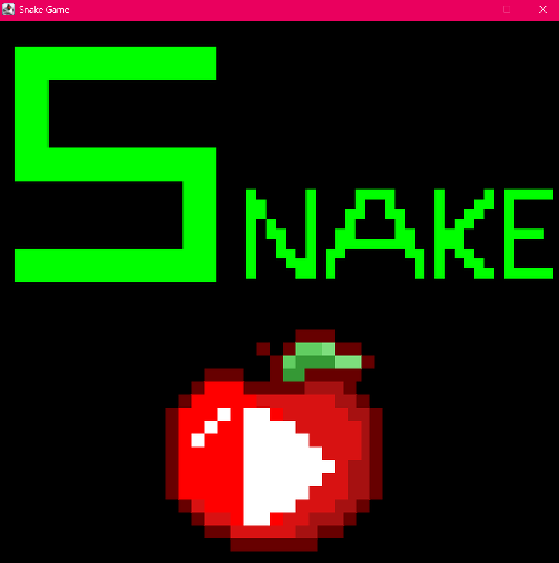
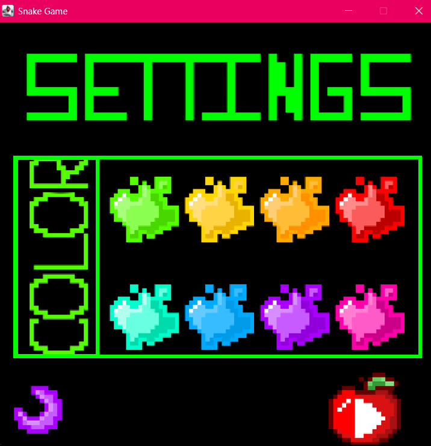
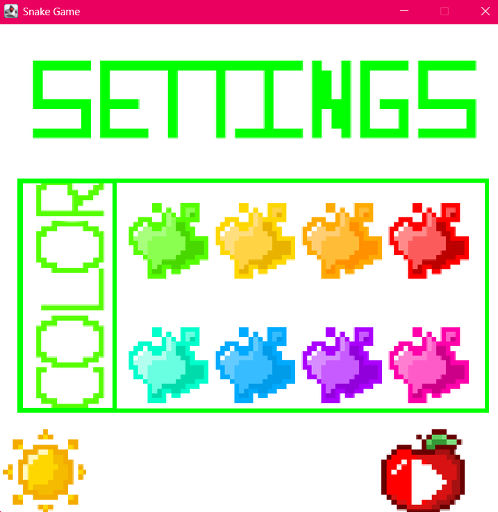
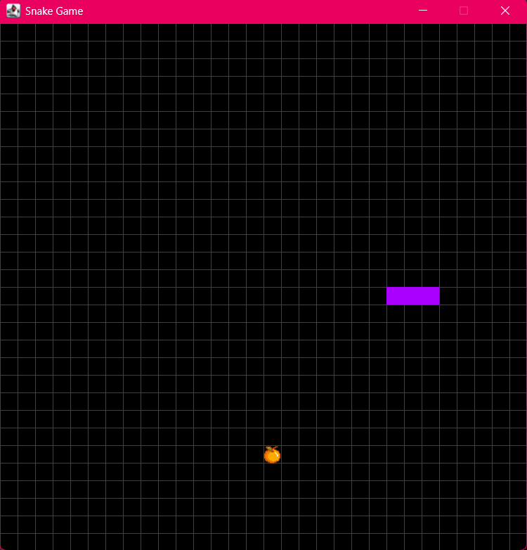
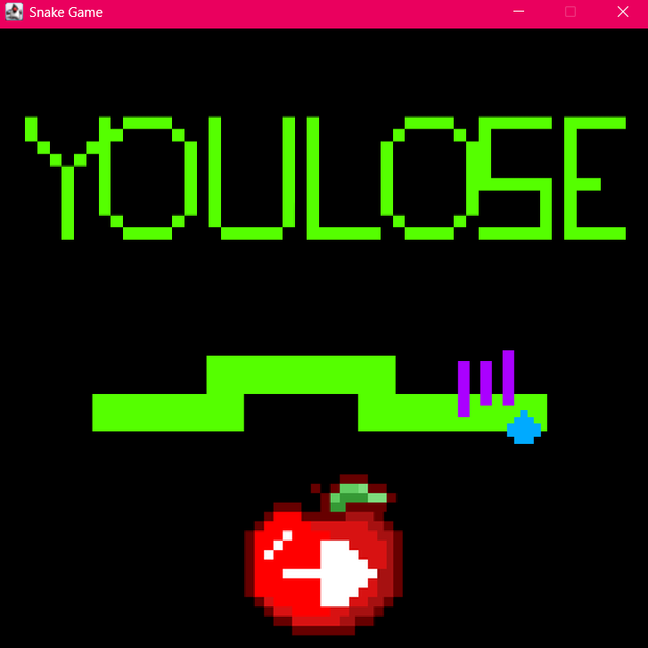
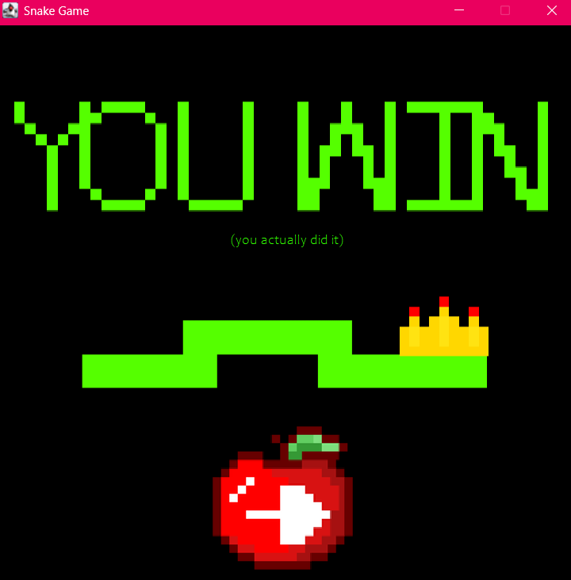
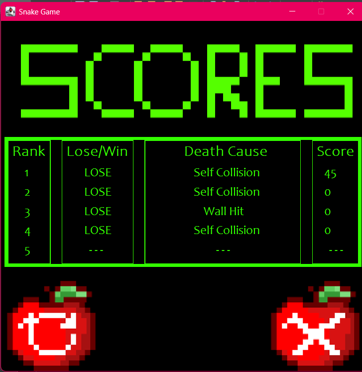

[Back to Portfolio](./)

Final Project - Snake
===============

-   **Class:** Object Oriented Programming - CSCI 325
-   **Grade:** 95/100
-   **Language(s):** Java
-   **Source Code Repository:** [Snake](https://github.com/jessica1620/csci325-Fall25-Snake)  
    (Please [email me](mailto:jmgambino@student.csuniv.edu?subject=GitHub+Access) to request access.)
    (Please view the `Presentations` section for a video demo!)

## Project description

For this project, I worked with a group to recreate the popular game Snake as our final project. The point of the game is to fill the entire screen with your snake without crashing into yourself or the walls. In regular Snake, there is just one snake and one fruit. In our recreation, we added a day/night mode, snake color settings, and multiple fruits amounting to different points. There is an apple (worth 5 points), orange (worth 10 points), banana (worth 15 points), and a strawberry (worth 20 points). The snake grows when eating one of the fruits, gaining points, and making the game more difficult in turn. The key features are movement via arrow keys and WASD, score and death tracking, game over and win screens. The game also features sounds.

## How to compile and run the program

To run the program, you must download the zip file from the repository, extract it, and run it within NetBeans.

## UI Design

The game opens up with a welcome start screen (see Fig 1), and upon clicking play, the user is brought to the settings screen (see Fig 2). The default color mode is `night mode`, but the user can choose to switch it to `day mode` if they choose by clicking the moon icon (see Fig 3). To switch back to night mode, hit the sun icon. The player can choose the color of the snake they would like. Afterwards, they may click play and begin playing (see Fig 4). The user may play the game for as long as they are able/choose. Upon crashing into yourself or into a wall, the user are brought to a losing screen (see Fig 5). However, if the user fill the entire screen without crashing into yourself, the user is brought to a winning screen (see Fig 6). After a win or lose screen, the next screen (by selecting the apple) is a scoreboard that tracks your points and deaths (see Fig 7). The user may replay as many times as they like, or close the game at that point by hitting the `X` apple.

  
Fig 1. The game start screen.

  
Fig 2. Snake settings (night mode).

  
Fig 3. Snake settings (day mode).

  
Fig 4. Snake gameplay example.

  
Fig 5. Snake losing screen.

  
Fig 6. Snake winning screen.

  
Fig 7. Example of the scoreboard and death tracking after win or loss screen.

## 3. Additional Considerations

The game is single player, but it can be improved with making it multiplayer.

For more details see [GitHub Flavored Markdown](https://guides.github.com/features/mastering-markdown/).

[Back to Portfolio](./)
